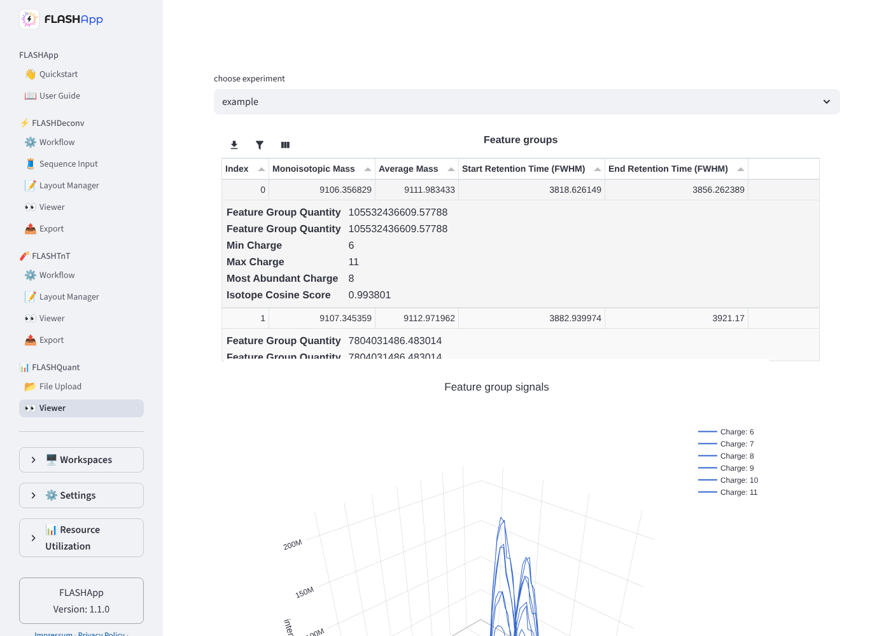
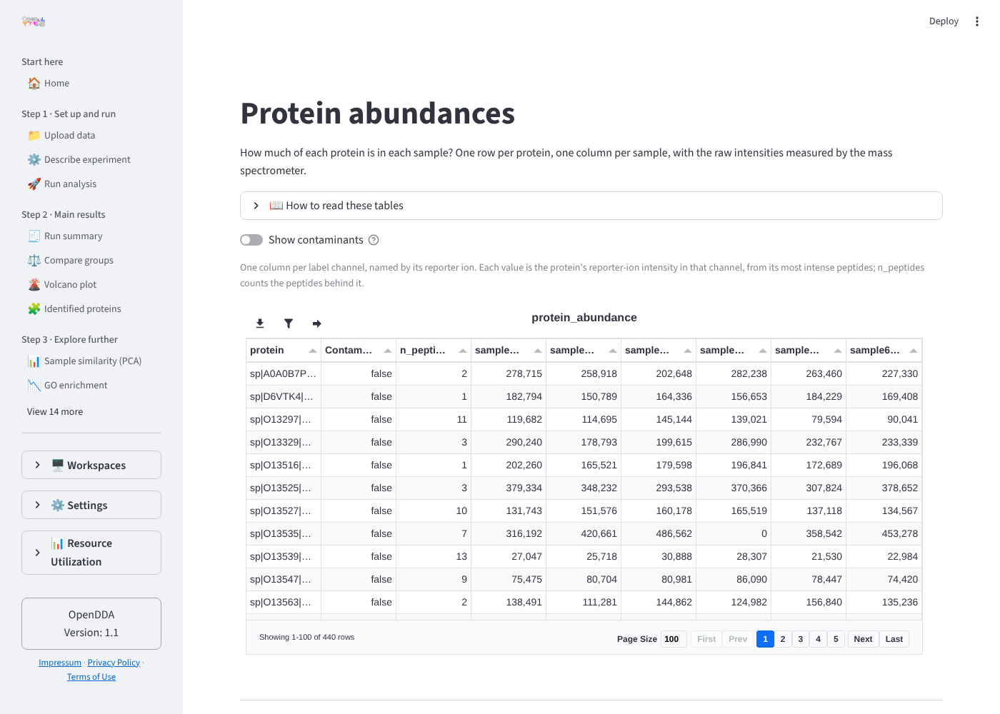
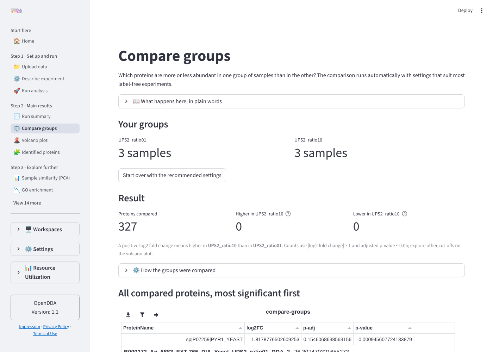
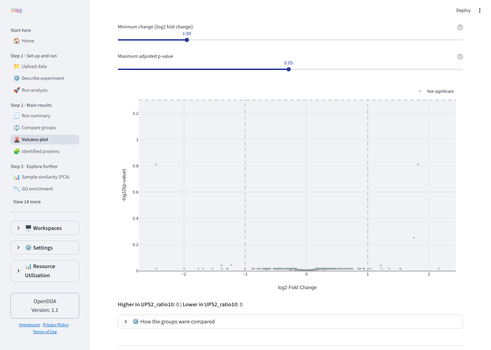
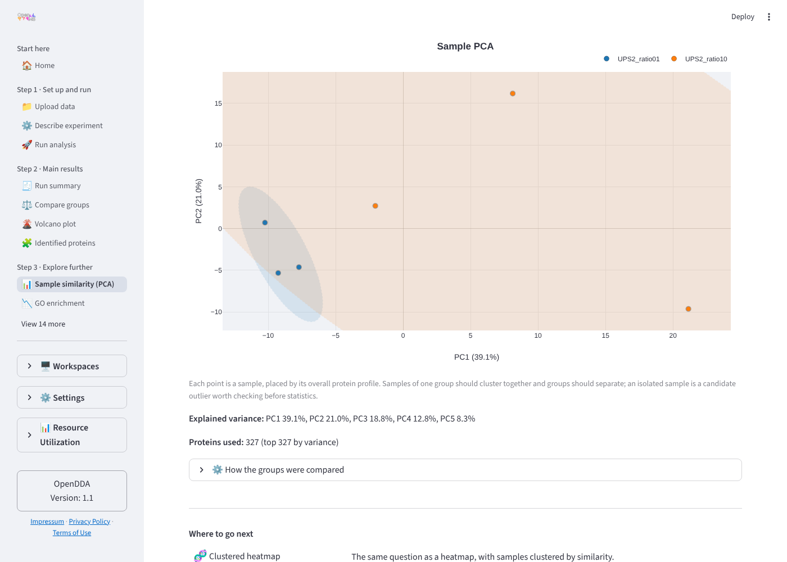
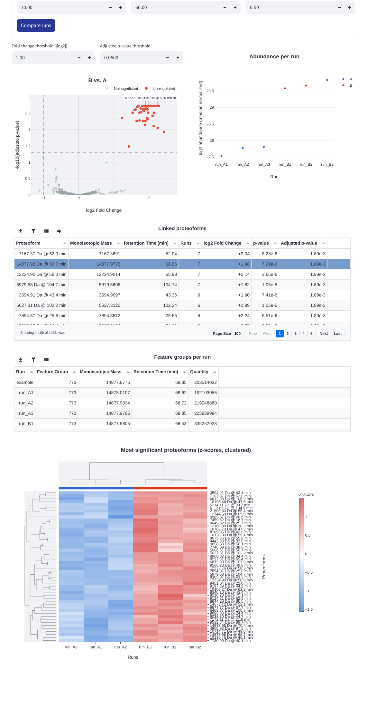

# Quantification feature spec

One feature list for quantification and differential analysis across the OpenMS web apps. It
says what each feature takes in, how it is computed, what it writes, how it is shown and which
parameters it has, and where every app stands. Use it to keep the apps in sync and as the
checklist when quantification comes to a new app.

Surveyed on 2026-11-02 at: quantms-web (OpenDDA) `main` 0961fbd, FLASHApp `develop` 9584eb3
and branch `claude/project-thread-y0mgos-quant` 6ba4aca, OpenDIAKiosk `main`, umetaflow `main`,
openms-insight 0.4.0.

## How to use this document

- **Changing a shared feature** (part B): change it here first, then in the place named under
  "Where the code lives", then in the apps. The status table is updated in the same PR that
  changes an app.
- **Adding quantification to an app**: implement one producer from part A that writes the
  abundance matrix contract, then take part B as it is. The checklist at the end lists the steps.
- Status: ✅ on the default branch · 🟡 on a branch or open PR · 🔶 present but different from
  this spec · ❌ missing · — does not apply.

## Shared data contracts

Everything in part B works on these three tables, whatever produced them. A producer in part A
is done when it writes them.

**C1 Abundance matrix.** One row per quantified entity (protein, proteoform, peptide, metabolite
feature), one column per sample, raw (not log) abundances, null for not measured.

| Column | Type | Note |
|---|---|---|
| id column | str | entity label shown in tables and plots (`ProteinName`, `Proteoform`, …); apps name it, `get_id_column` finds it |
| one column per sample | float | name = sample name in C2 |
| optional annotation columns | any | e.g. `MonoisotopicMass`, `RT`, `Runs`, accession; kept through the chain, not used for statistics |

**C2 Experimental design.** Sample → condition, plus biological replicate and fraction where the
experiment has them. The template's `ExperimentalDesign.py` (OpenMS two-table format,
`experimental-design.tsv`) is the store; `StreamlitUI.experimental_design()` is the editor, with
design.tsv and SDRF import.

**C3 Statistics table.** C1's id column plus `log2FC`, `p-value`, `p-adj`, `stat`. Sign
convention: a positive log2FC means higher in the second condition of the comparison
(`comparison_groups()` decides the order and the pages say which group is which).

## Part A: producers (app-specific)

Each app quantifies with its own TOPP chain. These stay app-owned; the spec only fixes their
output (C1, C2).

| ID | Producer | Inputs | Processing | Raw outputs | OpenDDA | FLASHApp | OpenDIAKiosk | UmetaFlow |
|---|---|---|---|---|---|---|---|---|
| A1 | DDA label-free | mzML, FASTA, design | CometAdapter → PercolatorAdapter → IDFilter → ProteomicsLFQ (`-design` when fractions > 1) | `openms_quant.mzTab`, `openms.consensusXML`, `openms_msstats.csv` | ✅ | — | — | — |
| A2 | DDA isobaric (TMT/iTRAQ) | mzML, FASTA, channel → group | IsobaricAnalyzer → CometAdapter → PercolatorAdapter → IDFilter → IDMapper → FileMerger → ProteinInference → IDConflictResolver → ProteinQuantifier (all as `-TMT` instances) | ProteinQuantifier table | ✅ | — | — | — |
| A3 | Top-down proteoforms | FLASHQuant `*fq.tsv`, `*fq.mts.tsv`, optional `*fq_shared.tsv` | Upload only; the FLASHQuant TOPP tool is not in current OpenMS (`develop` has no FLASHQuant source), so the app cannot run it | parsed `quant_dfs` per run | — | ✅ (view-only) | — | — |
| A4 | DIA | mzML, spectral library | OpenSwathAssayGenerator → OpenSwathDecoyGenerator → OpenSwathWorkflow → PyProphet (score, infer, export) | precursor, peptide and protein matrix TSVs | — | — | ✅ matrices, no C1/C2 hand-off | — |
| A5 | Untargeted metabolomics | mzML | FeatureFinderMetabo → MetaboliteAdductDecharger → MapAlignerPoseClustering / MapRTTransformer → FeatureLinkerUnlabeledKD | consensus feature table | — | — | — | ✅ matrix, no C1/C2 hand-off |

### Cross-run linking

| ID | Feature | How | OpenDDA | FLASHApp | OpenDIAKiosk | UmetaFlow |
|---|---|---|---|---|---|---|
| A6 | Link one entity across runs | Proteins: inside ProteomicsLFQ / ProteinQuantifier. Proteoforms: pyOpenMS `FeatureGroupingAlgorithmKD` (the FeatureLinkerUnlabeledKD algorithm) on feature groups with monoisotopic mass as "m/z" and apex RT, with RT warping. Metabolites: FeatureLinkerUnlabeledKD. DIA: PyProphet export. | ✅ | 🟡 (`src/parse/quant_compare.py::link_runs`, ppm `10`, RT `60` s) | ✅ | ✅ |

### Per-run viewers

| ID | Feature | Visualization | OpenDDA | FLASHApp | OpenDIAKiosk | UmetaFlow |
|---|---|---|---|---|---|---|
| A7 | Per-run feature table with signal traces | Insight `Table` (feature groups) linked through `StateManager` (`feature_group`) to `Plot3D` mass traces by charge | — | ✅ FLASHQuant Viewer | 🔶 own result viewer (Plotly) | 🔶 own feature chromatograms (Plotly) |

## Part B: shared downstream (the sync target)

From here on the features are the same in every app; only the entity name in the text
("protein", "proteoform", "metabolite") changes.

### B1 Experimental design

- **Inputs**: list of samples (files or runs).
- **Processing**: `ExperimentalDesign.py` (Streamlit-free).
- **Output**: C2 as `experimental-design.tsv` in the workflow (or run) directory.
- **UI**: `StreamlitUI.experimental_design()`, with design.tsv and SDRF import.

| OpenDDA | FLASHApp | OpenDIAKiosk | UmetaFlow |
|---|---|---|---|
| ✅ (#59; conditions mirrored to `mzML-group-*` by `src/common/lfq_design.py`; TMT uses `TMT-group-<channel>`) | 🔶 own `st.data_editor` (Run, Condition) on the Compare page, saved in the compare cache | ❌ | ❌ |

### B2 Abundance table

- **Inputs**: C1.
- **Output**: shown as is, downloadable.
- **Visualization**: `show_insight_table()` (Insight `Table`, server-side paging, CSV download).
- **Parameters**: include contaminants (default off, see B10).

| OpenDDA | FLASHApp | OpenDIAKiosk | UmetaFlow |
|---|---|---|---|
| ✅ Protein abundances | 🟡 "Linked proteoforms" table | 🔶 matrix tables | 🔶 |

### B3 Comparison chain: filter → impute → transform/normalize/scale → test → adjust

One call, `run_differential(df, sample_group_map, settings)`, over the `openms_insight.analysis`
functions. It returns the four intermediate tables (`filtered_df`, `imputed_df`, `normalized_df`,
`statistics_df`) so step pages and diagnostics can show each stage.

| Step | openms-insight function | Setting key | Options | Default |
|---|---|---|---|---|
| Filter | `filter_low_repeatability`, `filter_low_abundance`, `filter_low_variance` | `postproc-filter-method` | Low Repeatability, Low Abundance, Low Variance | Low Repeatability |
| | | `postproc-filter-max-missing` | 0–100 % (max share of missing values in at least one condition) | 50.0 |
| | | `postproc-filter-abundance-percentile` | 0–100 % | 10.0 |
| | | `postproc-filter-variance-percentile` | 0–100 % | 10.0 |
| Impute | `impute_smallest_value` (MNAR), `impute_mar` (MAR) | `postproc-impute-class` | MNAR (Missing Not At Random), MAR (Missing At Random) | MNAR |
| | | `postproc-impute-mnar-scope` | row, global | row |
| | | `postproc-impute-mar-strategy` | median, mean | median |
| Transform | `transform_data` | `postproc-transform` | None, log2, log10, square_root, cube_root | log2 |
| Normalize | `normalize_samples` | `postproc-normalization` | None, sum, median, pqn, reference_feature, quantile | median |
| Scale | `scale_data` | `postproc-scaling` | None, mean_centering, auto_scaling, pareto_scaling, range_scaling | None |
| Test | `calculate_statistical_tests` | `postproc-stat-test` | 2 conditions: limma_like, welch, paired. More than 2: limma_like, anova | limma_like |
| Adjust | `adjust_fdr_lazy` | `postproc-fdr` | BH, Bonferroni, None | BH |

- **Inputs**: C1, C2. At least two conditions; `valid_test()` falls back to a test that fits
  the number of conditions.
- **Output**: C3.
- `reference_feature` normalization needs an entity the user names; apps without that input
  must not offer it (FLASHApp's copy has no input for it).

| OpenDDA | FLASHApp | OpenDIAKiosk | UmetaFlow |
|---|---|---|---|
| ✅ `src/common/differential.py` | 🟡 `src/parse/differential.py`, a copy of OpenDDA's with the defaults inlined and the messages reworded | ❌ | 🔶 `src/stats.py`: mean log2 fold change between two groups, no test, no FDR |

### B4 Compare page (one-click comparison)

The entry page: pick samples and conditions (B1), run B3 with the defaults, show counts up and
down, the volcano (B5) and the sorted statistics table. A "Comparison settings" expander holds
every B3 setting; "How the groups were compared" lists the settings used
(`describe_settings()`); "Start over with the recommended settings" resets them.

- **Parameters**: B3 settings; display cut-offs `|log2FC| ≥ 1` and `p-adj ≤ 0.05`
  (`count_significant(fc=1.0, padj=0.05)`).
- OpenDDA additionally offers the four steps as separate "Fine-tune the comparison" pages
  (Filter proteins, Missing values, Normalize, Statistical test) that share the same settings
  keys. Apps may leave those out; the expander is required.

| OpenDDA | FLASHApp | OpenDIAKiosk | UmetaFlow |
|---|---|---|---|
| ✅ Compare groups + 4 step pages | 🟡 Compare Runs (expander only, plus linking tolerances) | ❌ | ❌ |

### B5 Volcano plot

- **Inputs**: C3.
- **Visualization**: Insight `VolcanoPlot` (`log2fc_column="log2FC"`, `pvalue_column="p-adj"`,
  `label_column=<id>`, up `#E74C3C`, down `#3498DB`, not significant `#95A5A6`, dashed threshold
  lines, `max_labels=10`), cached through `plot_cache()`. Linked by `StateManager` to the
  statistics table, so a click on a point selects the row.
- **Parameters**: FC cut-off slider 0.5–3.0 (1.0), adjusted p-value slider 0.001–0.1 (0.05).
- FLASHApp also draws the selected entity's abundance per sample (`SeriesPlot`, colored by
  condition) next to the volcano. Proposed for every app.

| OpenDDA | FLASHApp | OpenDIAKiosk | UmetaFlow |
|---|---|---|---|
| ✅ Volcano plot page (no per-sample plot) | 🟡 with per-sample `SeriesPlot` | ❌ | ❌ (fold-change bar chart only) |

### B6 PCA

- **Inputs**: `normalized_df` from B3, C2 for colors.
- **Visualization**: Insight `PCAPlot` (`sample_id_field="sample_id"`, `group_field="group"`,
  `n_components=5`), explained variance per PC, the input matrix in an expander via
  `show_insight_table()`.

| OpenDDA | FLASHApp | OpenDIAKiosk | UmetaFlow |
|---|---|---|---|
| ✅ Sample similarity (PCA) | 🟡 | ❌ | ❌ |

### B7 Clustered heatmap

- **Inputs**: z-scores of the most significant entities from B3, C2 for the condition bar.
- **Visualization**: Insight `ClusteredHeatmap` (row and column dendrograms, condition color
  bar). OpenDDA also has a plain `Heatmap` page of all entities.

| OpenDDA | FLASHApp | OpenDIAKiosk | UmetaFlow |
|---|---|---|---|
| ✅ Clustered heatmap + Heatmap | 🟡 | 🔶 Jaccard overlap heatmap (Plotly), not abundances | 🔶 Plotly heatmap with dendrogram |

### B8 Diagnostics of the chain

Plotly figures through `show_fig()` (theme-aware): filter threshold curve, missingness vs
intensity, imputed value preview, sample distributions before and after normalization, p-value
histogram. Source: `postprocessing_plots.py`, identical in both apps.

| OpenDDA | FLASHApp | OpenDIAKiosk | UmetaFlow |
|---|---|---|---|
| ✅ on the step pages | 🟡 "Diagnostics" view on Compare Runs | ❌ | ❌ |

### B9 GO enrichment

- **Inputs**: C3 and UniProt accessions in the id column. Changed entities (both cut-offs) are
  tested against all quantified entities as background.
- **Processing**: `openms_insight.analysis.enrichment.calculate_go_enrichment` (MyGene.info
  annotations, Fisher's exact test) for BP, CC, MF. Needs internet access; the page says so.
- **Visualization**: one tab per category: Plotly bar chart (`follow_app_theme()`) and
  `show_insight_table()`.
- **Parameters**: p-value cut-off (on `p-adj` when present), FC cut-off.
- Applies only where entities map to UniProt accessions: proteins in OpenDDA and OpenDIAKiosk;
  proteoforms only once identified (FLASHTnT protein hits); not metabolites (a pathway
  enrichment would be the metabolomics counterpart).

| OpenDDA | FLASHApp | OpenDIAKiosk | UmetaFlow |
|---|---|---|---|
| ✅ GO enrichment (`content/results_pathway_analysis.py` is an older, unregistered copy and can go) | — until identified proteoforms are quantified | ❌ | — |

### B10 Contaminants

Entities from the cRAP database (`CON__` accessions) are flagged and left out of B2–B9 by default
(`src/common/contaminants.py`, `get_abundance_data(include_contaminants=False)`).

| OpenDDA | FLASHApp | OpenDIAKiosk | UmetaFlow |
|---|---|---|---|
| ✅ | — | ❌ | — |

### B11 Per-sample counts and run summary

Quantified entities per sample (Plotly bar via `show_fig()`) and key figures of the run.

| OpenDDA | FLASHApp | OpenDIAKiosk | UmetaFlow |
|---|---|---|---|
| ✅ Per-sample counts, Run summary | 🟡 "Runs" column in the linked table only | 🔶 | 🔶 |

### B12 Runs, settings and export

- Results belong to a run (template `multi_run = True`); every quant page draws the run picker
  and reads the run's parameters with `self.runs.params(run_id)`.
- B3 settings used for a result are stored with it and shown with it.
- Every table downloads as CSV from the Insight toolbar (filtered, in the current sort,
  formula-injection safe from openms-insight 0.3.1); all result files from the download page.

| OpenDDA | FLASHApp | OpenDIAKiosk | UmetaFlow |
|---|---|---|---|
| ✅ | 🔶 FLASHQuant results are uploads per dataset, not runs; compare settings saved in the compare cache | 🔶 | 🔶 |

## Status at a glance

| Feature | OpenDDA | FLASHApp | OpenDIAKiosk | UmetaFlow |
|---|---|---|---|---|
| A6 Link across runs | ✅ | 🟡 | ✅ | ✅ |
| A7 Per-run feature viewer | — | ✅ | 🔶 | 🔶 |
| B1 Experimental design | ✅ | 🔶 | ❌ | ❌ |
| B2 Abundance table | ✅ | 🟡 | 🔶 | 🔶 |
| B3 Comparison chain | ✅ | 🟡 (copy) | ❌ | 🔶 |
| B4 Compare page | ✅ | 🟡 | ❌ | ❌ |
| B5 Volcano | ✅ | 🟡 | ❌ | ❌ |
| B6 PCA | ✅ | 🟡 | ❌ | ❌ |
| B7 Clustered heatmap | ✅ | 🟡 | 🔶 | 🔶 |
| B8 Diagnostics | ✅ | 🟡 | ❌ | ❌ |
| B9 GO enrichment | ✅ | — | ❌ | — |
| B10 Contaminants | ✅ | — | ❌ | — |
| B11 Per-sample counts | ✅ | 🟡 | 🔶 | 🔶 |
| B12 Runs and export | ✅ | 🔶 | 🔶 | 🔶 |

FLASHApp's 🟡 items are all on `claude/project-thread-y0mgos-quant` (commit 1d56dab, "Compare
runs: reuse OpenDDA's comparison chain and views"), which has no PR yet.

## Where the code lives

Today B3 and B8 exist twice: `quantms-web/src/common/differential.py` and
`FLASHApp/src/parse/differential.py` differ only in their messages and in where the defaults
come from; `postprocessing_plots.py` is the same file in both. That is the first thing to fix
before a third app copies them.

| Piece | Home | Why |
|---|---|---|
| B3 `run_differential`, `default_settings`, `describe_settings`, `count_significant`, `comparison_groups`, `valid_test` | openms-insight, as `openms_insight.analysis.differential` | It is a thin layer over `openms_insight.analysis`, Streamlit-free, and the template does not depend on openms-insight |
| B8 diagnostic figures | openms-insight, as `openms_insight.analysis.plots` (Plotly) | Same inputs as B3; used by every app that has B3 |
| B1 design editor and store | streamlit-template (already there) | Template-level, no openms-insight needed |
| B4–B7, B9 pages | each app, following this spec | Pages carry app wording and navigation; the components and settings they use are fixed here |
| Part A producers | each app | Different TOPP chains |

## Checklist: quantification in a new app

1. Write a producer (part A) that ends in C1, with sample names matching C2.
2. Use `ui.experimental_design()` for C2 (B1). Do not add a separate condition editor.
3. Call `run_differential` with `default_settings()`; store the settings with the result (B3, B12).
4. Add the Compare page with the settings expander and the settings summary (B4).
5. Add B5, B6, B7 with the Insight components and parameters above, linked through one
   `StateManager`. Use `plot_cache()` for plots of session-computed data and
   `show_insight_table()` for tables; never `st.dataframe` for full-size results.
6. Add B8 and, for UniProt-mapped proteins, B9.
7. Update the status table here in the same PR.

## Open questions

- FLASHQuant cannot run in FLASHApp because the tool is not in current OpenMS. Bring it back as a
  TOPP tool, or quantify from FLASHDeconv output in pyOpenMS?
- FLASHApp's linking step (A6) is pyOpenMS glue in the app. If other top-down or intact-mass apps
  need it, it should become a TOPP tool option (FeatureLinkerUnlabeledKD on mass instead of m/z).
- OpenDIAKiosk and UmetaFlow have matrices but no C1/C2 hand-off. Each needs a small adapter from
  its matrix to C1 before part B can be taken over.
